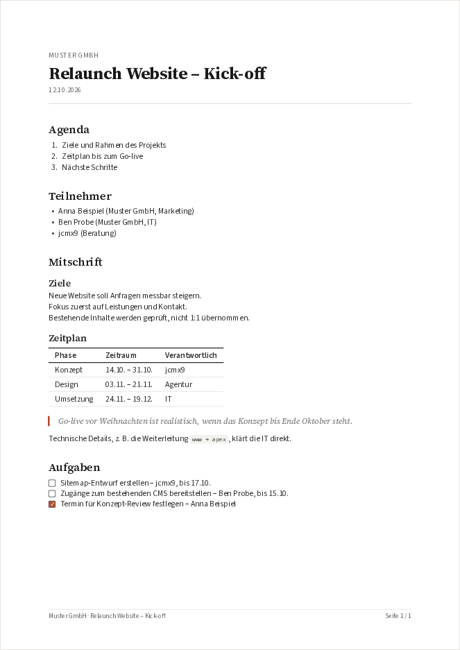

# Zettlr PDF Export Theme

> Clean, client-ready PDFs from Zettlr notes – plus a matching editor theme for Zettlr and Typora, built on Adobe's Source type family.

[](https://github.com/jcmx9/zettlr_PDF-Export-Theme/actions/workflows/ci.yml)
[](LICENSE)

Write meeting notes live in Zettlr – topic, agenda, participants, notes, tasks – and export them with one click as a calm, typographic A4 PDF. Everything involved is free and open source: Zettlr, Pandoc (ships with Zettlr) and [Typst](https://typst.app).



| Element     | Font            |
| ----------- | --------------- |
| Headings    | Source Serif 4  |
| Body        | Source Sans 3   |
| Code        | Source Code Pro |
| Emoji       | Noto Emoji      |

The Source fonts are Adobe's variable OTF builds. Emoji use the monochrome Noto Emoji, so they follow the text color and weight in the PDF, Zettlr and Typora. All fonts are bundled with the theme; nothing is loaded from the internet at runtime.

## Install and update

One line per system. Run the same line again to update.

**macOS / Linux**

```bash
curl -fsSL https://raw.githubusercontent.com/jcmx9/zettlr_PDF-Export-Theme/main/install.sh | bash
```

**Windows** (PowerShell, no admin rights needed)

```powershell
irm https://raw.githubusercontent.com/jcmx9/zettlr_PDF-Export-Theme/main/install.ps1 | iex
```

The installer

1. downloads the latest release and verifies its SHA-256 checksum,
2. downloads Typst into its own folder if needed (no system changes),
3. sets up **Zettlr** if installed: editor theme, export profile **Source PDF**, snippet **protokoll**,
4. sets up **Typora** if installed: themes Source, Source Dark, Source Compact, Source Dark Compact.

Existing rules in Zettlr's `custom.css` are kept; a timestamped backup is written before every change.

| | macOS | Linux | Windows |
| --- | --- | --- | --- |
| Installer files | `~/.local/share/zettlr-pdf-export-theme` | `~/.local/share/zettlr-pdf-export-theme` | `%LOCALAPPDATA%\zettlr-pdf-export-theme` |
| Zettlr | `~/Library/Application Support/zettlr` | `~/.config/zettlr` | `%APPDATA%\zettlr` |
| Typora | `~/Library/Application Support/abnerworks.Typora/themes` | `~/.config/Typora/themes` | `%APPDATA%\Typora\themes` |

### Uninstall

```bash
curl -fsSL https://raw.githubusercontent.com/jcmx9/zettlr_PDF-Export-Theme/main/install.sh | bash -s -- --uninstall
```

```powershell
& ([scriptblock]::Create((irm https://raw.githubusercontent.com/jcmx9/zettlr_PDF-Export-Theme/main/install.ps1))) -Uninstall
```

## Usage in Zettlr

1. Restart Zettlr after installing.
2. New note: type `:protokoll` and press Enter. Tab jumps through client, topic, agenda, participants, notes and tasks; the date is filled in automatically.
3. Export: **File → Export…** (<kbd>Cmd</kbd>/<kbd>Ctrl</kbd> + <kbd>E</kbd>), profile **Source PDF**.

Where the PDF is saved is set under *Preferences → Import and Export*.

### What the PDF supports

- **Title:** `# Topic` becomes the document title, `## Section` the section headings
- **Front matter (optional):** `client`, `date` (defaults to the export date), `subtitle`, `author`
- **Line breaks:** every line break in the note is kept
- **Tasks:** `- [ ]` / `- [x]` render as check boxes
- **Alerts:** `> [!NOTE]` (Info), `[!TIP]` (Tipp), `[!IMPORTANT]` (Wichtig), `[!WARNING]` (Hinweis, calm orange), `[!CAUTION]` (Achtung); German keywords such as `> [!HINWEIS]` work as well
- **Text:** `==highlight==`, footnotes, tables, code with syntax colors, math, typographic quotes, German hyphenation, emoji (monochrome, in text color)
- **Footer:** client, title and page numbers

### Editor theme

The editor theme works with every built-in Zettlr theme; Zettlr's *Appearance → Editor theme* setting no longer matters. Light and dark follow Zettlr's dark mode. It sets fonts, heading sizes (scale 1.25 for levels 1–3, body size from level 4), spacing and colors. To try Zettlr without it, comment out the first line of `custom.css` in Zettlr's *Assets Manager*.

Tags are shown in the accent color including their `#`. Zettlr itself does not support `/` in tags: `#project/client` is read as the tag `#project` followed by plain text. Use `-` or `_` for hierarchies, e.g. `#project-client`.

## Typora

The installer adds four themes to Typora: **Source**, **Source Dark**, **Source Compact** and **Source Dark Compact**. Choose them from the **Themes** menu after restarting Typora. To switch with the system appearance, enable *Preferences → Appearance → Use separate theme in dark mode* and select **Source Dark**.

Typora's own PDF export uses the active theme: A4 margins, no page breaks inside code blocks, tables or quotes. Page numbers are set under *Preferences → Export → PDF*, e.g. `${pageNo} / ${totalPages}` in the footer.

## Typography

- Old-style figures in running text and headings, lining tabular figures in tables, neutral figures in code – in the PDF and both editors. Source Sans draws its old-style figures subtly, so they are easiest to spot in the Source Serif headings
- Emoji are monochrome and follow the weight of the surrounding text. Exception in Zettlr: emoji written with an explicit color selector (e.g. ⚠️, ❤️) stay in color, because Chromium always renders those with the system color font
- All text colors meet WCAG AA contrast, checked by `scripts/check_contrast.py`

## Development

```bash
# Lint tooling
npm install
npm run lint:css
shellcheck install.sh scripts/*.sh
uvx ruff check scripts/

# Color contrast (WCAG AA) and Zettlr palette sync
python3 scripts/check_contrast.py

# Re-download fonts (Adobe releases, Noto Emoji from google/fonts)
uv run scripts/fetch_fonts.py

# Build the release bundle and install it locally
./scripts/package.sh
./install.sh --bundle dist/zettlr-pdf-export-theme.tar.gz

# PDF from the command line
pandoc note.md -f markdown+hard_line_breaks+mark+alerts-smart -t pdf --pdf-engine=typst \
  --pdf-engine-opt=--ignore-system-fonts --pdf-engine-opt=--font-path=typst/fonts \
  --template=typst/source.typst --lua-filter=typst/source.lua \
  --shift-heading-level-by=-1 -o note.pdf
```

CI lints everything and runs the installer on Ubuntu, macOS and Windows (PowerShell 5.1).

## Project Structure

```
install.sh, install.ps1   – Installers (macOS/Linux, Windows)
VERSION                   – Release version (CalVer)
typst/source.typst        – Pandoc template for the PDF
typst/source.lua          – Pandoc filter (alerts, typographic quotes)
typst/fonts/              – Variable OTF fonts for Typst
typst/example-meeting.md  – Example meeting note
zettlr/                   – Zettlr editor theme, export profile template, snippet
source*.css               – Typora themes
source/                   – Web fonts (Typora) and embedded fonts (Zettlr)
scripts/                  – Font download, contrast check, bundle build
docs/                     – README images
```

## Versioning

[CalVer](https://calver.org/) in the format `YY.M.MICRO`, stored in `VERSION`. Pushing a tag `v<version>` builds the bundle and creates a GitHub release; the installers always fetch the latest release.

## License

Code and theme: MIT – see [LICENSE](LICENSE).
Fonts: SIL Open Font License 1.1 – see `typst/fonts/OFL-*.txt`. Source is a trademark of Adobe; Noto is a trademark of Google.
