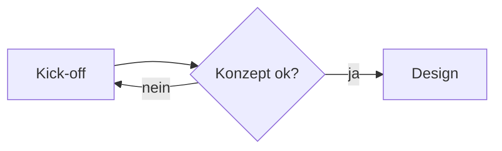

# Source – Elementtest

## Text

Fließtext mit **fett**, *kursiv*, ==markiert==, `Inline-Code` und einem [Link](https://www.zettlr.com).
Diese Zeile folgt ohne Leerzeile – der Zeilenumbruch bleibt erhalten.

„Deutsche Anführungszeichen“ und ‚einfache‘ sowie Emojis 👍 💡.[^1]

## Hinweisboxen

> [!NOTE]
> Ergänzende Information.

> [!WARNING]
> Ruhiges Orange.

> [!HINWEIS]
> Deutsches Schlüsselwort.

## Bild

{width=50%}

## Diagramm



\newpage

## Lange Tabelle

| Nr. | Position | Betrag |
| --: | :------- | -----: |
| 1 | Zeile | 100,00 € |
| 2 | Zeile | 100,00 € |
| 3 | Zeile | 100,00 € |
| 4 | Zeile | 100,00 € |
| 5 | Zeile | 100,00 € |
| 6 | Zeile | 100,00 € |
| 7 | Zeile | 100,00 € |
| 8 | Zeile | 100,00 € |
| 9 | Zeile | 100,00 € |
| 10 | Zeile | 100,00 € |
| 11 | Zeile | 100,00 € |
| 12 | Zeile | 100,00 € |
| 13 | Zeile | 100,00 € |
| 14 | Zeile | 100,00 € |
| 15 | Zeile | 100,00 € |
| 16 | Zeile | 100,00 € |
| 17 | Zeile | 100,00 € |
| 18 | Zeile | 100,00 € |
| 19 | Zeile | 100,00 € |
| 20 | Zeile | 100,00 € |
| 21 | Zeile | 100,00 € |
| 22 | Zeile | 100,00 € |
| 23 | Zeile | 100,00 € |
| 24 | Zeile | 100,00 € |
| 25 | Zeile | 100,00 € |
| 26 | Zeile | 100,00 € |
| 27 | Zeile | 100,00 € |
| 28 | Zeile | 100,00 € |
| 29 | Zeile | 100,00 € |
| 30 | Zeile | 100,00 € |
| 31 | Zeile | 100,00 € |
| 32 | Zeile | 100,00 € |
| 33 | Zeile | 100,00 € |
| 34 | Zeile | 100,00 € |
| 35 | Zeile | 100,00 € |
| 36 | Zeile | 100,00 € |
| 37 | Zeile | 100,00 € |
| 38 | Zeile | 100,00 € |
| 39 | Zeile | 100,00 € |
| 40 | Zeile | 100,00 € |
| 41 | Zeile | 100,00 € |
| 42 | Zeile | 100,00 € |
| 43 | Zeile | 100,00 € |
| 44 | Zeile | 100,00 € |

## Code

```python
def total(rows: list[float]) -> float:
    return sum(rows)  # 4.400,00
```

## Aufgaben

- [ ] Sitemap-Entwurf erstellen – jcmx9, bis 17.10.
- [ ] Zugänge bereitstellen – Ben Probe, bis 15.10.
- [x] Termin festlegen – Anna Beispiel
- [ ] Offener Punkt ohne Zuständigkeit

## Checkliste

- [ ] Ohne Zuständigkeit bleibt es eine Liste
- [x] Erledigt

[^1]: Eine Fußnote.
